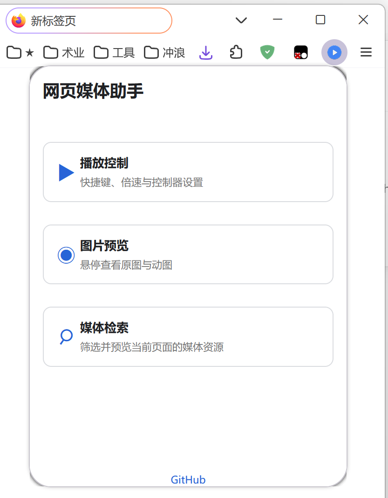
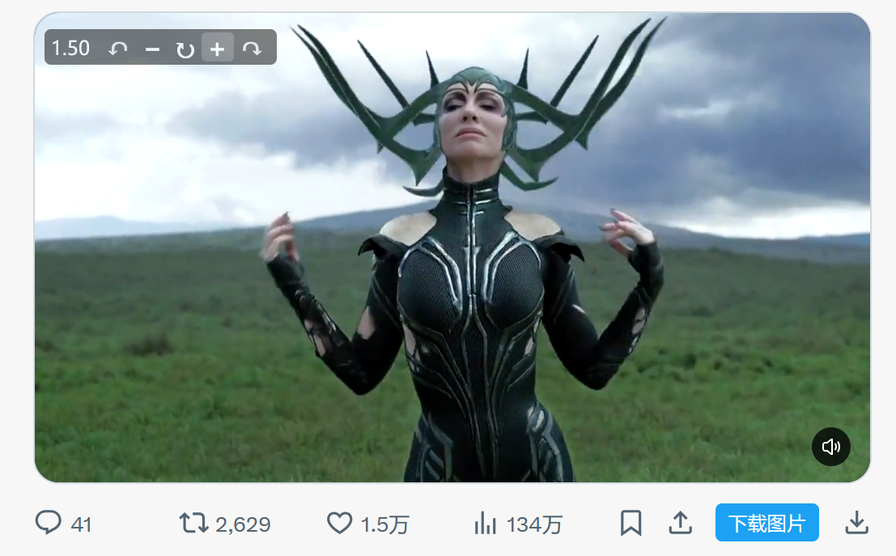
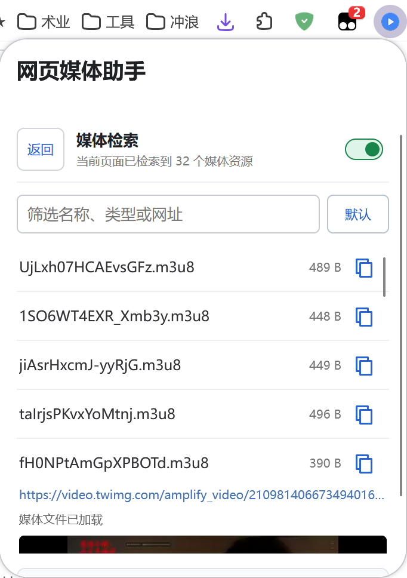

# 网页媒体助手

[English](README_en.md)

一个 Firefox 网页媒体工具箱，三个功能可独立启用：

- 播放控制：倍速、进度快捷键和页面控制器。
- 图片预览：悬停放大页面现有图片或动图，支持 `srcset`、背景图、直接图片链接和安全的预览规则。
- 媒体检索：查找、预览和下载当前页面加载的媒体资源。

图片预览保留 Imagus 0.9.8.74 的预览界面与交互，以通用图片检测为基础。预览规则使用安全的 URL 模板：`*` 保留原内容，`%s` 标记替换位置，每个 `%s` 都对应一个 `[]` 候选分组。命中规则时，贴图标题以 `[orig]` 或 `[值1][值2]` 的形式显示当前值，点击任一分组可独立按组内顺序切换。规则不执行脚本、不请求解析页面，且生成地址不能改变原图片域名。默认规则覆盖 X / Twitter、TMDb、Pinterest、SoundCloud、Apple 媒体图片、Squarespace、Gravatar、Discord、YouTube、eBay、Google 图片 CDN、Unsplash、GitHub 头像、Flickr、ArtStation 和 Twitch 头像的明确尺寸 URL。当前版本不提供视频预览。

## 扩展下载

[从 Firefox 附加组件商店安装](https://addons.mozilla.org/zh-CN/firefox/addon/web-media-assistant/)

## 更新日志

[查看版本更新记录](CHANGELOG.md)

## 预览

| 扩展首页 | 播放控制 | 图片预览 | 媒体检索 |
| --- | --- | --- | --- |
|  |  |  |  |

## 许可

本项目原创的整合代码、设置界面和 UI 设计采用 MIT License。第三方代码仍使用各自许可，详见 [LICENSE](LICENSE) 和 [THIRD_PARTY_NOTICES.md](THIRD_PARTY_NOTICES.md)。Imagus 相关文件不在 MIT 授权范围内。
