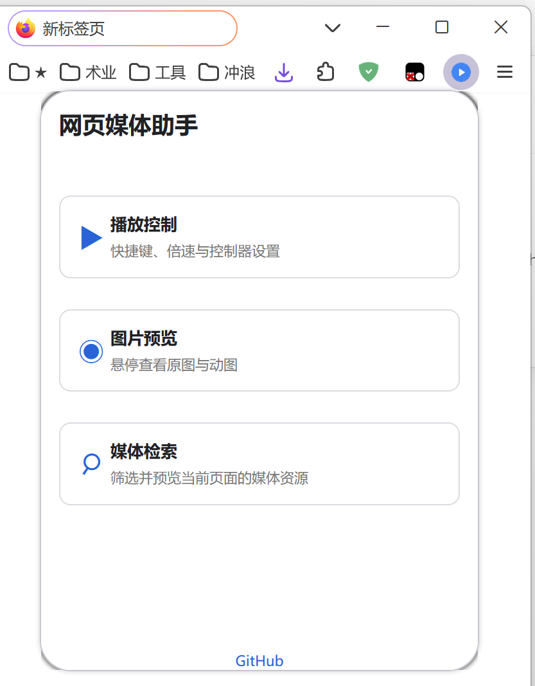
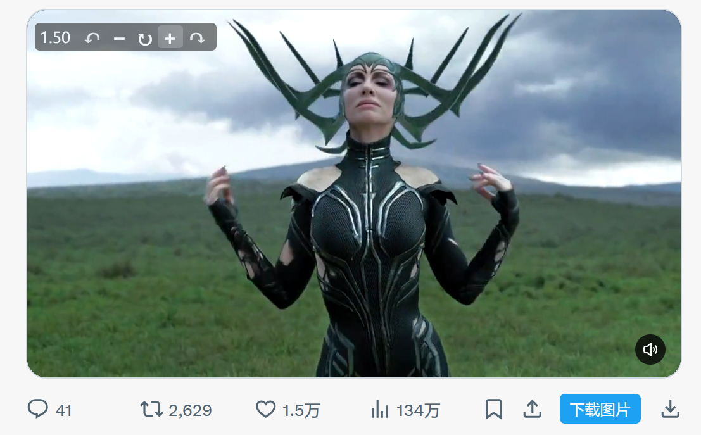
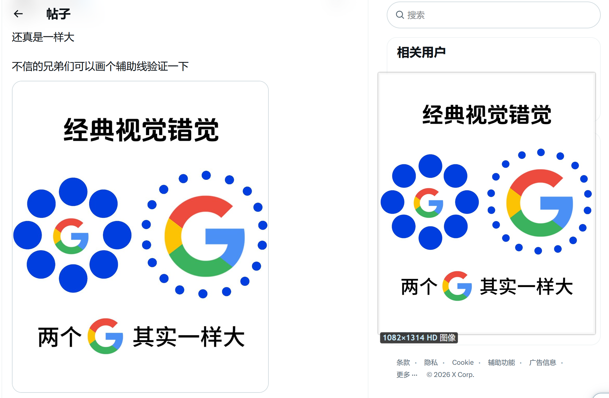
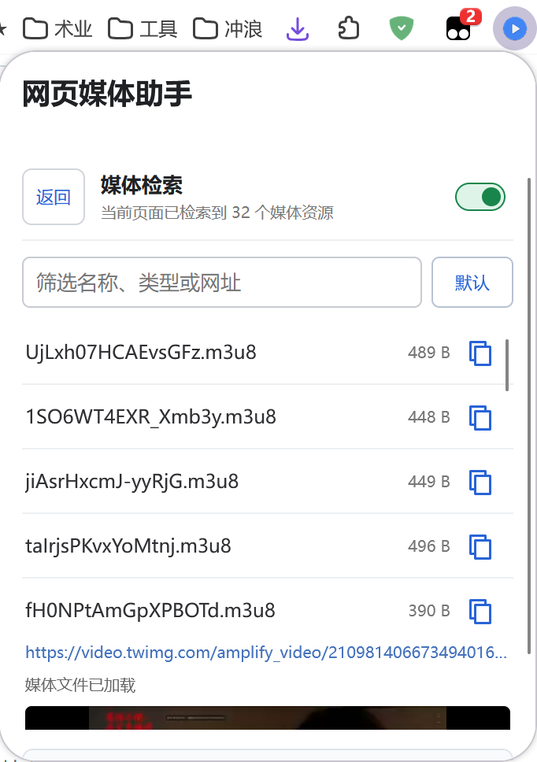

# 媒体助手

[English](README_en.md)

一个同时面向桌面端与移动端 Firefox 的网页媒体工具箱，三个功能可独立启用：

- 播放控制：倍速、进度快捷键和页面控制器。
- 图片预览：快速放大、贴图查看页面中的图片或动图，支持 `srcset`、背景图、直接图片链接和安全的 URL 预览规则。
- 媒体检索：查找、预览和下载当前页面加载的媒体资源。

支持桌面版 Firefox 与 Firefox for Android 142.0 及更高版本。鼠标继续使用悬停、右键、触发设置和键盘快捷键；触摸或触控笔固定使用移动端手势，即使同时连接鼠标也不会改变。Android 触屏设备可长按图片开始预览，轻触放大图或页面其他位置可关闭未贴图预览，在放大图上双指同时轻触可贴图；贴图后可单指移动，并用双指缩放或旋转，旋转接近 0°、90°、180°、270° 时自动吸附。桌面端和触屏端均可按住播放控制器任意区域拖动；移动端轻触速度数字可在仅显示数字和展开全部按钮之间切换。Android 下载通过扩展内文件保存页面交给浏览器或系统分享处理。HLS 下载采用有界分片并发，但下载和大文件合并仍会占用较多内存，实际能力取决于设备配置。

图片预览以 Imagus 0.9.8.74 的部分代码为基础，但预览界面、规则管理以及鼠标和触摸交互均已针对本扩展重做。桌面端支持悬停预览、右键贴图和鼠标操作；移动端支持长按预览、轻触关闭、双指贴图，以及贴图后的拖动、缩放和旋转。预览规则采用受限的 URL 模板，仅在原图片域名内切换可选规格，不执行脚本，也不请求解析页面。扩展内置了一组常用规则，用户也可以在设置中查看、启停、排序或添加规则。当前版本不提供视频预览。

## 扩展下载

[从 Firefox 附加组件商店安装](https://addons.mozilla.org/zh-CN/firefox/addon/web-media-assistant/)

## 更新日志

[查看版本更新记录](CHANGELOG.md)

## 预览

| 扩展首页 | 播放控制 | 图片预览 | 媒体检索 |
| --- | --- | --- | --- |
|  |  |  |  |

## 许可

本项目原创的整合代码、设置界面和 UI 设计采用 MIT License。第三方代码仍使用各自许可，详见 [LICENSE](LICENSE) 和 [THIRD_PARTY_NOTICES.md](THIRD_PARTY_NOTICES.md)。Imagus 相关文件不在 MIT 授权范围内。
