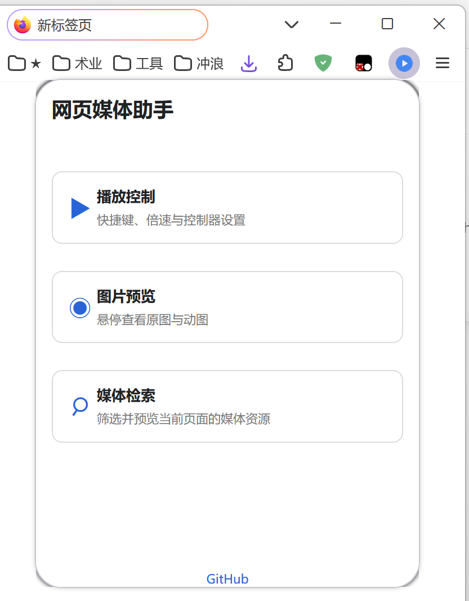
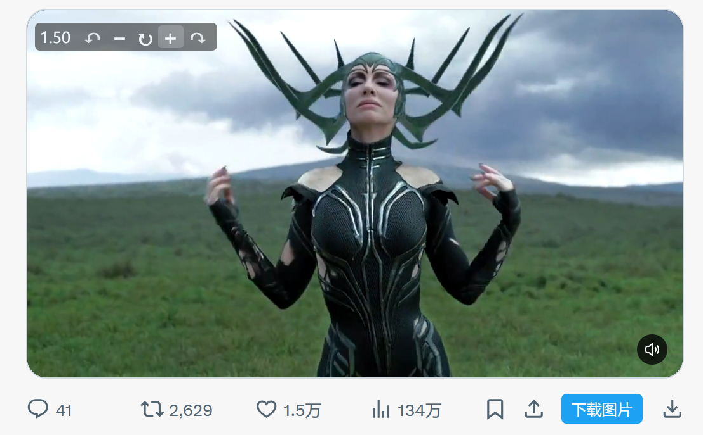
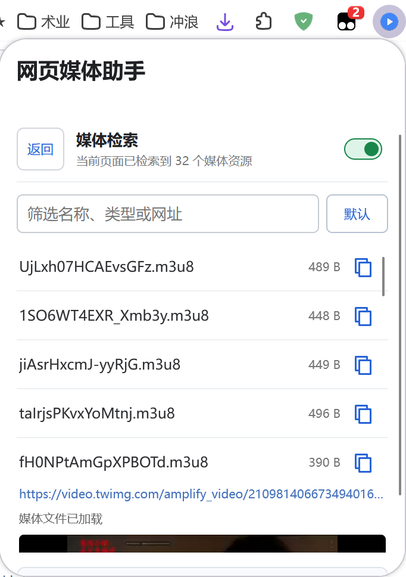

# Media Assistant

[中文](README.md)

A Firefox media toolbox for desktop and mobile.

## Main features

- Playback controls: speed, seeking shortcuts, and an on-page controller.
- Image preview: enlarge or pin images and animations found on a page.
- Media finder: find, preview, and download media loaded by the current page.

Each feature can be enabled independently.

## Platform support

- Desktop: mouse hover, right-click, dragging, and keyboard shortcuts.
- Mobile: Firefox for Android 142.0 or later.
- Touch: press and hold to preview, tap to close, and tap with two fingers to pin; pinned images can be dragged, pinched, and rotated.
- The playback controller is fully draggable. On mobile it starts collapsed and can collapse automatically.
- Android downloads are handed to the browser or system through an extension save page.

## Image preview

Image preview is based on parts of the Imagus 0.9.8.74 codebase, while its viewer, rule management, and interactions have been reworked for this extension.

- Supports `srcset`, background images, direct image links, and large or tall images.
- Rotation snaps near the four cardinal orientations.
- Included preview rules can be reviewed, enabled, disabled, reordered, and extended.
- Rules run no scripts and cannot switch away from the original image host.
- Video preview is not included.

## Download

[Install from Firefox Add-ons](https://addons.mozilla.org/zh-CN/firefox/addon/web-media-assistant/)

## Changelog

[View release notes](CHANGELOG_en.md)

## Preview

| Extension menu | Playback controls | Image preview | Media finder |
| --- | --- | --- | --- |
|  |  |  |  |

## License

Original integration code, settings UI, and UI design created for this project are available under the MIT License. Third-party code keeps its original terms; see [LICENSE](LICENSE) and [THIRD_PARTY_NOTICES.md](THIRD_PARTY_NOTICES.md). Imagus-derived files are outside the MIT grant.
